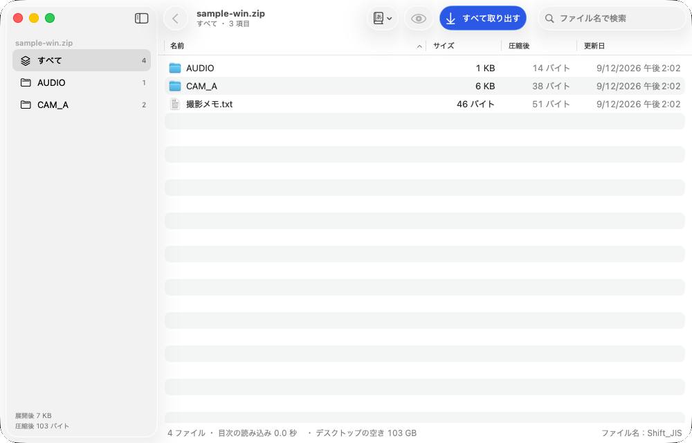
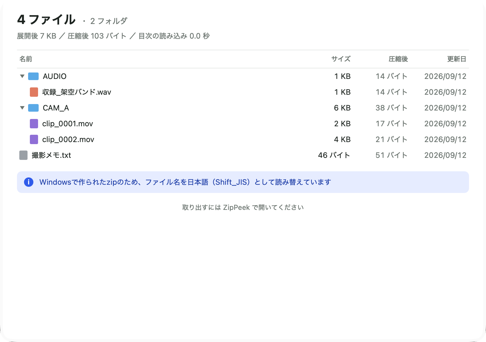
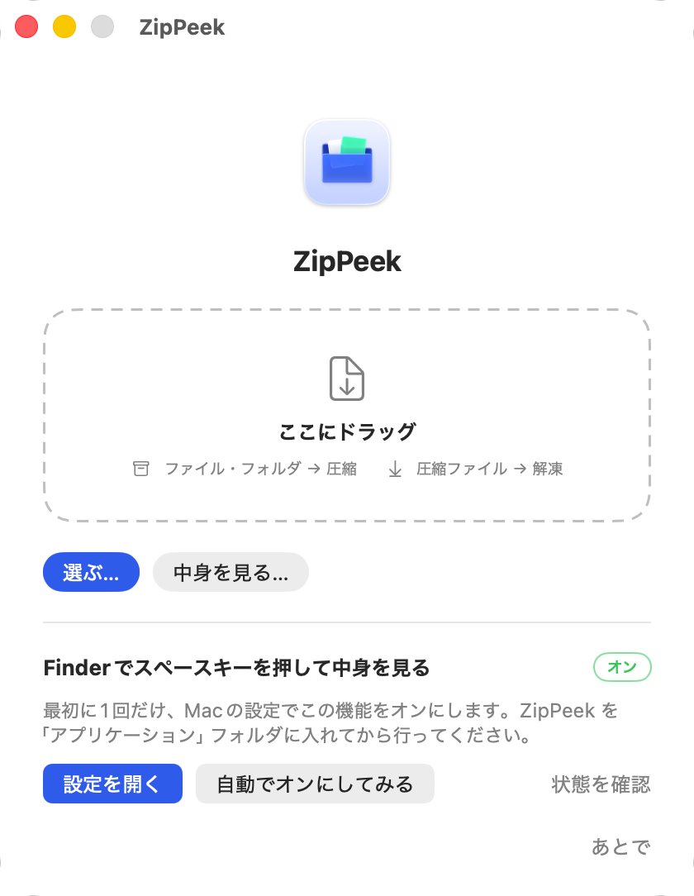

  <picture>
    <source media="(prefers-color-scheme: dark)" srcset="brand/logo/zippeek-wordmark-white.svg">
    
  </picture>

<b>Macの圧縮・解凍。そして、展開せずにのぞく。</b> 
Finderでスペースキーを押せばzipの中身が見えて、必要な1ファイルだけ取り出せます。Windowsで作ったzipの文字化けもしません。無料・オープンソース。

  <a href="https://github.com/kajisho5/zippeek/releases/latest"><b>ダウンロード</b></a> ·
  <a href="https://kajisho5.github.io/zippeek/ja/">配布ページ</a> ·
  <a href="#よくある質問">よくある質問</a> ·
  <a href="README.md">English</a> ·
  <a href="https://github.com/sponsors/kajisho5">♡ 寄付する</a>

  
  
  

## 目次

- [ZipPeekでできること](#zippeekでできること)
- [入れ方](#入れ方)
- [使い方](#使い方)
- [対応形式](#対応形式)
- [設定](#設定)
- [プライバシー](#プライバシー)
- [よくある質問](#よくある質問)
- [開発](#開発)
- [寄付のお願い](#寄付のお願い)
- [ライセンス](#ライセンス)

## ZipPeekでできること

30GBのzipから1ファイルだけ欲しいとき、普通は30GBを全部展開するしかありません。ZipPeekはzipの末尾にある「目次」だけを読むので、どんなに大きくても中身の一覧がすぐに出ます。そこから必要なものだけ取り出せます。

| | |
|---|---|
| **スペースキーでのぞく** | Finderでzip・7z・rar・tarを選んでスペースキー。展開せずに、中のファイル・フォルダ・大きさが一覧で出ます。 |
| **1ファイルだけ取り出す** | ZipPeekの窓で選んで「取り出す」。デスクトップへのドラッグでも書き出せます。ファイルを選んでスペースキーでプレビューも。 |
| **中に足す・消す** | ZipPeekの窓にファイルをドラッグすればzip・7zに追加、選んでdeleteキーで削除。解凍して圧縮し直す必要はありません。変更の前に必ず確認します。 |
| **ドラッグで、すぐ** | Dockのアイコンやドラッグ先の窓にファイルを落とすと圧縮、圧縮ファイルを落とすと解凍。optionキーを押しながらだと逆の動きになります。 |
| **Finderの右クリック** | 「ZipPeekで圧縮」「ZipPeekで解凍」「ZipPeekで中身を見る」。 |
| **文字化けしない** | 日本語Windowsで作ったzip（Shift_JIS）の名前を自動で判定して正しく表示。作るzipは濁点が分かれない名前で保存するので、Windowsで「ハ゛」のようになりません。古いWindows向けのzipも作れます。 |
| **たくさんの形式** | zip・7z・rar・tar・gz・bz2・xz・zst・iso・lzh・cab などを解凍。zip・7z を作成。中身の処理に 7-Zip を同梱。 |
| **圧縮の設定** | パスワード（AES-256。7zはファイル名も隠せる）、分割、圧縮率、Mac専用の隠しファイル（.DS_Storeなど）を入れない。 |
| **Macらしい作り** | 標準のツールバー・メニュー・ショートカット、読み上げ（VoiceOver）、「視差効果を減らす」設定に対応。macOS 26ではLiquid Glass。ライト／ダークはMacの設定に自動で合わせます。 |
| **日本語・英語** | Macの言語設定に合わせて切り替わります。 |

<table>
<tr>
<td width="50%"></td>
<td width="50%"></td>
</tr>
<tr>
<td>Finderでスペースキーを押すと中身が見える</td>
<td>ファイルを落とせば圧縮、圧縮ファイルを落とせば解凍</td>
</tr>
</table>

## 入れ方

1. [リリース](https://github.com/kajisho5/zippeek/releases/latest) から `ZipPeek-*.dmg` をダウンロード
2. dmgを開き、**ZipPeek** を **アプリケーション** フォルダへドラッグ
3. ZipPeek を一度起動し、案内に沿って **Finderでスペースキーを押して中身を見る** をオン（案内のボタンでMacの設定が開きます）

動作環境：macOS 14（Sonoma）以降、Apple シリコン / Intel

**ダブルクリックで中身を見る：** 最初の窓の「ZipPeek で開くようにする」を押し、Macの確認で許可すると、zip・7z・rar をダブルクリックしたときにZipPeekの窓で中身が開きます（Windowsと同じ感覚です）。Dockのアイコンへのドラッグは、これまでどおりすぐ解凍します。どちらの動きも、Mac標準に戻すことも「設定」→「一般」で変えられます。

## 使い方

**中身を見る**
- Finderで圧縮ファイルを選んで **スペースキー**
- 窓で開くなら、右クリック →「ZipPeekで中身を見る」、またはメニューの「ファイル」→「中身を見る…」（⇧⌘O）

**中に足す・消す**（zip・7z）
- ZipPeekの窓にファイルをドラッグ、またはツールバーの「追加…」。いま見ているフォルダに入ります
- 選んで **deleteキー**、または右クリック →「圧縮ファイルから削除…」

**一部だけ取り出す**
1. ZipPeekの窓でファイルやフォルダを選ぶ（右上の検索欄で探せます）
2. 「取り出す」を押すか、デスクトップやFinderの窓へドラッグ
3. 何も選んでいないときは「すべて取り出す」になります

**圧縮する**
- Dockのアイコンやドラッグ先の窓にファイル・フォルダを落とす、または右クリック →「ZipPeekで圧縮」
- 設定のシートで zip／7z、パスワード、分割などを選べます。「次回から聞かずに、この設定で圧縮する」で省略でき、optionキーを押しながら落とすとまた出ます

**解凍する**
- 圧縮ファイルをDockのアイコンに落とす、または右クリック →「ZipPeekで解凍」
- 標準では元のファイルと同じ場所に出し、中身が複数ならフォルダにまとめます

**文字化けしているとき**
- ツールバーの「ファイル名の文字コード」で読み方を切り替えます

## 対応形式

| | |
|---|---|
| **解凍** | zip・7z・rar・tar・gz・bz2・xz・zst・iso・lzh・cab・arj・cpio・wim・xar・rpm・deb など |
| **作成** | zip・7z |
| **中に足す・消す** | zip・7z（パスワード付き・分割されたものは除く） |
| **できないこと** | rar形式での圧縮（rarの作成は開発元にしか許されていないため。解凍はできます） |

## 設定

メニューの「ZipPeek」→「設定…」（⌘,）

| タブ | 変えられること |
|---|---|
| 一般 | ダブルクリックでZipPeekを開く、ダブルクリックとDockへのドラッグそれぞれの動き（中身を見る／すぐ解凍）、解凍先、複数ならフォルダにまとめる、終わったらFinderで表示、解凍後に元のファイルをゴミ箱へ |
| 見た目 | 標準の窓／ガラスの小窓 |
| 圧縮 | 標準の形式と圧縮率、Windowsで文字化けしない名前、Mac専用の隠しファイルを入れない |
| スペースキー | スペースキーで中身を見る機能のオン |

パスワードは保存しません。

## プライバシー

ZipPeekはすべてMacの中だけで動きます。アカウントも利用状況の収集もなく、ファイルをどこかへ送ることもありません。スペースキーの表示は、Appleの隔離された仕組み（サンドボックス）の中で、選んだファイルを読むだけです。

## よくある質問

**アップデートは自動？**
0.2 からは自動で知らせます。1日に1回新しい版を確認し、入れる前に聞きます。同じ開発者の署名があるときだけ入れ替えて、再起動します。「設定」→「一般」でオフにでき、「ZipPeek」→「アップデートを確認…」でいつでも確認できます（0.1.0 にはこの機能がないので、一度だけ最新版を入れ直してください）。

**本当に無料？**
はい。MITライセンスのオープンソースです。

**スペースキーの機能をオンにする必要があるのはなぜ？**
新しいクイックルック（スペースキーの表示）の部品は、最初に1回だけMacの設定で許可が要ります。ZipPeekの設定で状態の確認と、設定画面を開くことができます。

**7zやrarもスペースキーで見られる？**
0.3から見られます。zip・7z・rar・tar（.tar.gzなども）に対応しています。ほかの形式は ZipPeek の窓で開けます（右クリック →「ZipPeekで中身を見る」）。

**zipの中にファイルを足したり消したりできる？**
0.3から、zipと7zでできます。ZipPeekの窓にファイルをドラッグする（またはツールバーの「追加…」）と、いま見ているフォルダに追加されます。選んでdeleteキーを押すと削除。変更の前に必ず確認します。パスワード付きや分割された圧縮ファイルは変更できません。Windows（Shift_JIS）の名前のzipからは削除できません。

**Windowsから来たzipの名前が化けている**
自動で判定しますが、外れたときはツールバーの「ファイル名の文字コード」で切り替えてください。

**作ったzipはWindowsで開ける？**
開けます。日本語の名前があるときは、圧縮の設定で「Windowsで文字化けしない名前にする」をオンにしてください。

**ダブルクリックでZipPeekを開くようにできる？**
できます。最初の窓か「設定」→「一般」の「ZipPeek で開くようにする」を押し、Macの確認で許可してください。Finderで「情報を見る」→「このアプリケーションで開く」でZipPeekを選び「すべてを変更…」を押す方法でもできます。

## 開発

画面は Apple の [Human Interface Guidelines](https://developer.apple.com/design/human-interface-guidelines)（HIG）に従います。ぶつかったときはHIGを優先し、例外にする場合は理由を書きます。開発の詳しい説明は [English の README](README.md#development) にあります。

## 寄付のお願い

ZipPeek は無料で、これからも無料です。役に立ったら、**[GitHub Sponsors](https://github.com/sponsors/kajisho5)** で開発を応援してもらえるとうれしいです。毎月でも1回だけでも、金額は自由です。リポジトリへのスター（★）や、知り合いに教えてもらうのも大きな応援になります。

## ライセンス

ZipPeek は [MIT License](LICENSE) です。

同梱：
- [7-Zip](https://www.7-zip.org/) 26.05（Igor Pavlov 作）— GNU LGPL + BSD 3-clause + unRAR の制限（[Vendor/7zip/License.txt](Vendor/7zip/License.txt)）
- [ZIPFoundation](https://github.com/weichsel/ZIPFoundation) 0.9.20 — MIT

画面写真とテストのファイル名はすべて架空のものです。
