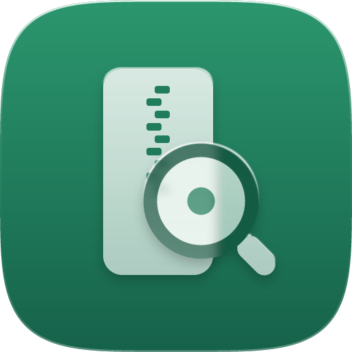

<p align="center"></p>

<h1 align="center">nozoki（のぞき）</h1>

<p align="center">Macで、zipを<b>展開せずに</b>中身を見て、必要なファイルだけ取り出す無料のツール</p>

---

Macの標準機能では、zipを選んでスペースキーを押しても大きなアイコンが出るだけです。20〜30GBの撮影素材のzipでも、全部展開しないと中身を確認できません。nozoki はそれを解決します。

## できること

- **Finderでスペースキー → 中身の一覧**：フォルダ構造・サイズ・更新日をその場で確認
- **巨大zipでも一瞬**：zipの末尾にある「目次」だけを読むので、30GBでも一覧はすぐ出ます
- **1ファイルだけ取り出す**：nozoki で開いて、選んで「取り出す」。デスクトップへのドラッグでも書き出せます
- **中のファイルをちょい見**：選んでスペースキーで、そのファイルだけ一時的に取り出してプレビュー
- **文字化けしない**：日本語Windowsで作ったzip（Shift_JIS）の日本語ファイル名を自動で判定。手動の切り替えも可能
- **4GB超のzip（ZIP64）対応**、検索、並べ替え

## 入れ方

1. [リリース](https://github.com/kajisho5/zippeek/releases) から `nozoki-*.dmg` をダウンロード
2. dmgを開き、nozoki を「アプリケーション」フォルダへドラッグ
3. nozoki を一度起動し、「はじめに」の画面で「設定を開く」→「クイックルック」の nozoki をオン

これでFinderでzipを選んでスペースキーを押すと中身が出ます。

zipをダブルクリックしたときは、これまでどおりMacの標準の解凍が動きます。nozoki で開きたいときは、zipを右クリック →「このアプリケーションで開く」→ nozoki。

## 動作環境

- macOS 14（Sonoma）以降
- Apple シリコン / Intel

## 今の版でできないこと

- zip以外（7z・rarなど）
- パスワード付きzipからの取り出し（一覧の表示はできます）
- 分割zip（.z01 など）
- zipの作成・編集

## 開発

Macが無くても開発できるよう、Xcodeのプロジェクトは `project.yml` から [XcodeGen](https://github.com/yonaskolb/XcodeGen) で作ります。

```sh
brew install xcodegen
xcodegen generate
open Nozoki.xcodeproj
```

| 場所 | 中身 |
| --- | --- |
| `Packages/NozokiCore` | zipの目次の読み取り・文字コード判定・取り出し（画面なし。テスト付き） |
| `Nozoki/` | アプリ本体（SwiftUI） |
| `NozokiPreview/` | Finderのスペースキー用の拡張（クイックルック拡張） |
| `.github/workflows/` | GitHubのMacでのビルド・テスト・配布 |

テスト：`cd Packages/NozokiCore && swift test`

使っている部品：[ZIPFoundation](https://github.com/weichsel/ZIPFoundation) 0.9.20（MIT）

## English

nozoki is a free, open-source macOS app that lets you peek inside ZIP files without extracting them. Press Space in Finder to see the file list (even for 30 GB archives, since only the central directory is read), open the archive in nozoki to extract just the files you need, and enjoy correct Japanese file names from Windows-made (Shift_JIS) archives. Requires macOS 14 or later.

## ライセンス

MIT License
