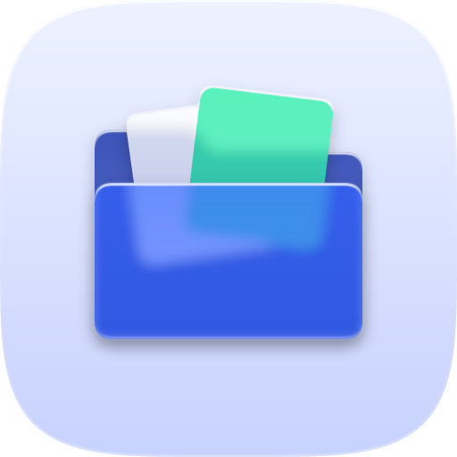
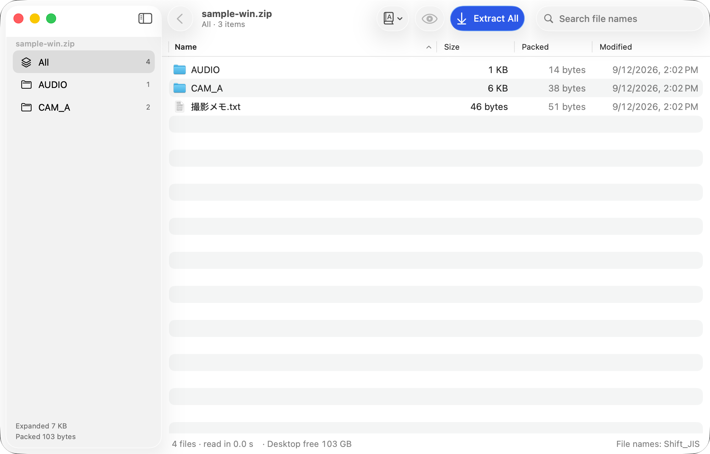
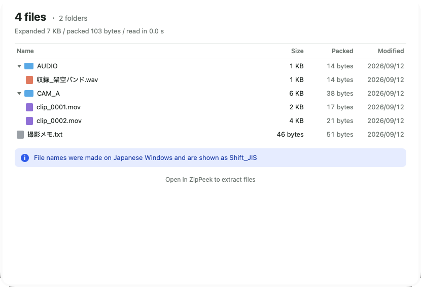
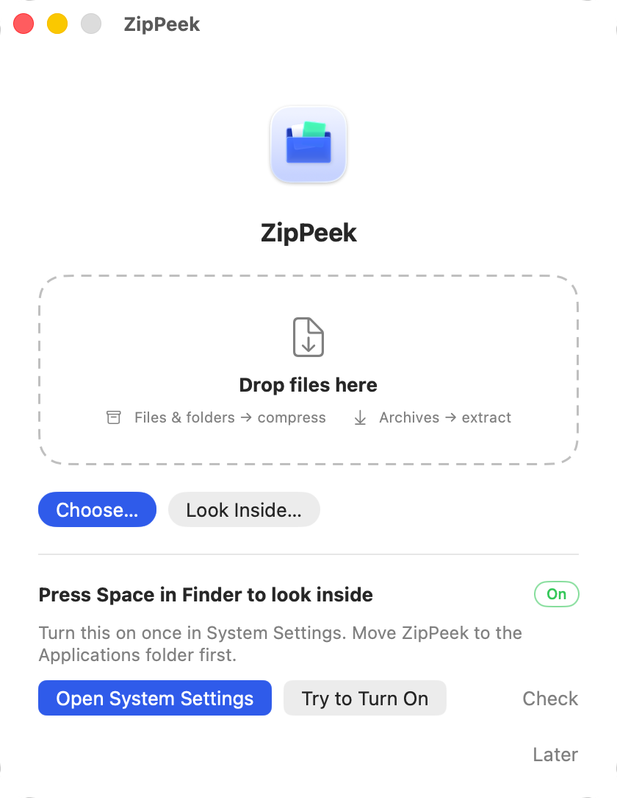

<p align="center"></p>

<p align="center">
  <picture>
    <source media="(prefers-color-scheme: dark)" srcset="brand/logo/zippeek-wordmark-white.svg">
    
  </picture>
</p>

<p align="center"><b>Compress and extract on your Mac — and peek inside without extracting.</b><br>
Press Space in Finder to see what's in a ZIP, take out just the file you need, and stop fighting garbled Japanese file names. Free and open source.</p>

<p align="center">
  <a href="https://github.com/kajisho5/zippeek/releases/latest"><b>Download</b></a> ·
  <a href="https://kajisho5.github.io/zippeek/">Website</a> ·
  <a href="#faq">FAQ</a> ·
  <a href="README.ja.md">日本語</a> ·
  <a href="https://github.com/sponsors/kajisho5">♡ Sponsor</a>
</p>

<p align="center">
  <a href="https://github.com/kajisho5/zippeek/actions/workflows/build.yml"></a>
  <a href="LICENSE"></a>
  
</p>



## Contents

- [Why ZipPeek](#why-zippeek)
- [Features](#features)
- [Install](#install)
- [How to use](#how-to-use)
- [Formats](#formats)
- [Settings](#settings)
- [Privacy](#privacy)
- [FAQ](#faq)
- [Development](#development)
- [Support ZipPeek](#support-zippeek)
- [License and credits](#license-and-credits)

## Why ZipPeek

You get a 30 GB ZIP and only need one file from it. The usual answer on a Mac is to extract all 30 GB first. ZipPeek reads only the archive's table of contents, which a ZIP stores at its end, so the file list appears right away however large the archive is. Then you take out just what you need.

It also covers the everyday side: drop files on the Dock icon to compress, drop an archive to extract, or use Finder's right-click menu.

## Features

| | |
|---|---|
| **Peek with the Space key** | Select a ZIP, 7z, rar or tar in Finder and press Space. A Quick Look preview lists every file, folder and size without extracting anything. |
| **Take out just one file** | Open the archive in ZipPeek, pick files or folders, and click **Extract**, or drag them straight to the Desktop. Press Space on a file to preview it. |
| **Add and remove files** | Drag files into the ZipPeek window to add them to a ZIP or 7z, or select items and press Delete to remove them — no extracting and re-compressing. ZipPeek asks before it changes anything. |
| **Drop to go** | Drop files on the Dock icon or the drop window to compress them. Drop an archive to extract it. Hold Option for the other action. |
| **Right-click in Finder** | *Compress with ZipPeek*, *Extract with ZipPeek* and *Look Inside with ZipPeek*. |
| **No garbled names** | Japanese file names in ZIPs made on Windows (Shift_JIS) are detected and shown correctly. ZIPs you make store names the way Windows expects (accented and kana characters stay whole, not split into parts), and you can also make ZIPs for older Japanese Windows. |
| **Many formats** | Extract zip, 7z, rar, tar, gz, bz2, xz, zst, iso, lzh, cab and more. Create zip and 7z. Powered by the bundled 7-Zip. |
| **Compression options** | AES-256 passwords (7z can hide file names too), split archives, compression level, and leaving out Mac-only files such as `.DS_Store`. |
| **Feels like a Mac app** | Standard toolbar, menus and shortcuts, VoiceOver labels, Reduce Motion support, and Liquid Glass on macOS 26. Light and dark follow your Mac's setting. |
| **English and Japanese** | Follows your Mac's language. |

<table>
<tr>
<td width="50%"></td>
<td width="50%"></td>
</tr>
<tr>
<td>Press Space in Finder to see what's inside.</td>
<td>Drop files to compress, drop archives to extract.</td>
</tr>
</table>

## Install

1. Download `ZipPeek-*.dmg` from [Releases](https://github.com/kajisho5/zippeek/releases/latest).
2. Open it and drag **ZipPeek** into **Applications**.
3. Launch ZipPeek once and follow the prompt to turn on **Press Space in Finder to look inside**. The prompt has a button that opens System Settings for you.

Requirements: macOS 14 Sonoma or later, Apple silicon or Intel.

**Double-click to look inside:** the first window has an **Open with ZipPeek** button. After you confirm in the Mac's dialog, double-clicking a ZIP, 7z or rar opens it in ZipPeek's window — like on Windows. Dropping an archive on the Dock icon still extracts it right away. You can change both, or go back to Archive Utility, in **Settings → General**.

## How to use

**Look inside an archive**
- In Finder, select the archive and press **Space**.
- For the full window: right-click → **Look Inside with ZipPeek**, or **File → Look Inside…** (⇧⌘O).

**Add or remove files** (zip and 7z)
- Drag files into the ZipPeek window, or click **Add Files…**. They go into the folder you're viewing.
- Select items and press **Delete**, or right-click → **Delete from Archive…**.

**Take out some files**
1. In the ZipPeek window, select files or folders. Use the search field at the top right to find them.
2. Click **Extract**, or drag them to the Desktop or any Finder window.
3. With nothing selected, the button reads **Extract All**.

**Compress**
- Drop files or folders on the Dock icon or the drop window, or right-click → **Compress with ZipPeek**.
- A sheet lets you choose zip or 7z, a password, splitting and more. Tick **Don't ask next time** to skip it; hold **Option** while dropping to see it again.

**Extract**
- Drop an archive on the Dock icon, or right-click → **Extract with ZipPeek**.
- By default, files go next to the archive, and multiple items are put in a folder.

**Garbled names?**
- If an archive shows strange characters, use the **File Name Encoding** button in the toolbar.

## Formats

| | |
|---|---|
| **Extract** | zip, 7z, rar, tar, gz, bz2, xz, zst, iso, lzh, cab, arj, cpio, wim, xar, rpm, deb and more |
| **Create** | zip, 7z |
| **Add / remove inside** | zip, 7z (not password-protected or split archives) |
| **Not supported** | Creating rar (only its developer may make rar archives; extracting works). |

## Settings

Open **ZipPeek → Settings…** (⌘,).

| Tab | What you can change |
|---|---|
| General | Double-click to open in ZipPeek; what double-clicking and Dock drops do (look inside, or extract right away); where to extract, putting multiple items in a folder, showing results in Finder, moving the archive to the Trash afterwards |
| Appearance | Standard drop window, or a compact glass drop target |
| Compression | Default format and level, Windows-friendly names, leaving out Mac-only files |
| Quick Look | Turning on the Space-key preview |

Passwords are never saved.

## Privacy

ZipPeek works entirely on your Mac. It has no accounts and no analytics, and it never sends your files anywhere. The Quick Look preview runs in Apple's sandbox with read-only access to the file you selected.

## FAQ

**Does ZipPeek update itself?**
Yes, from version 0.2 on. Once a day ZipPeek checks for a new version and asks before updating. It installs the update only if it's signed by the same developer, then restarts. You can turn this off in Settings → General, or check any time with **ZipPeek → Check for Updates…**. (Version 0.1.0 can't do this — please download the latest version once.)

**Is it really free?**
Yes. ZipPeek is open source under the MIT License.

**Why does the Space-key preview need to be turned on?**
macOS asks you to approve new Quick Look extensions once. ZipPeek's settings show whether it's on and open System Settings for you.

**Does the Space-key preview work for 7z and rar?**
Yes, from version 0.3: zip, 7z, rar and tar (including .tar.gz). Other formats open in the ZipPeek window (right-click → Look Inside with ZipPeek).

**Can I add or remove files inside a ZIP?**
Yes, from version 0.3, for zip and 7z. Drag files into the ZipPeek window (or use **Add Files…** in the toolbar) to add them to the folder you're viewing. Select items and press Delete to remove them. ZipPeek asks before changing the archive. Password-protected and split archives can't be changed, and items can't be deleted from a ZIP with Windows (Shift_JIS) names.

**My ZIP came from Windows and the names look broken.**
ZipPeek detects Shift_JIS names automatically. If the guess is wrong, switch it with **File Name Encoding** in the toolbar.

**Will a ZIP I make open on Windows?**
Yes. For Japanese names, turn on **Japanese Windows–friendly names** in the compression sheet.

**Can ZipPeek open ZIPs when I double-click them?**
Yes. Click **Open with ZipPeek** in the first window or in Settings → General, then confirm in the Mac's dialog. You can also do it in Finder: **Get Info** on a ZIP, pick ZipPeek under **Open with**, and click **Change All…**.

## Development

The UI follows Apple's [Human Interface Guidelines](https://developer.apple.com/design/human-interface-guidelines). When they conflict with implementation convenience, the HIG wins; any exception is documented here.

The Xcode project is generated from `project.yml` with [XcodeGen](https://github.com/yonaskolb/XcodeGen), so everything builds on GitHub Actions without a local Mac. Every push runs the tests (including real compress and extract runs with 7-Zip), builds the app, checks the bundle and the translations, and takes screenshots on a Mac.

```sh
bash scripts/fetch-7zip.sh   # fetch 7-Zip 26.05 (version and checksum pinned)
brew install xcodegen
xcodegen generate
open ZipPeek.xcodeproj
```

| Path | Contents |
| --- | --- |
| `Packages/ZipPeekCore` | Archive engine: table-of-contents reader, encoding detection, compress and extract, with tests |
| `ZipPeek/` | The app (SwiftUI). UI text is in `Resources/Localizable.xcstrings` (English source, Japanese translation) |
| `ZipPeekPreview/` | Quick Look extension for the Space key |
| `design/icon/` | App icon sources (layered `.icon`) |
| `brand/` | Icon and wordmark used in this README |
| `site/` | Website (Astro) |
| `scripts/` | 7-Zip download, bundle checks, screenshots |

Tests: `cd Packages/ZipPeekCore && ZIPPEEK_7ZZ=../../Vendor/7zip/7zz swift test`

## Support ZipPeek

ZipPeek is free and will stay free. If it saves you time, please consider supporting its development on **[GitHub Sponsors](https://github.com/sponsors/kajisho5)** — monthly or one-time, any amount helps. Starring the repo and telling a friend helps too.

## License and credits

ZipPeek is released under the [MIT License](LICENSE).

Bundled:
- [7-Zip](https://www.7-zip.org/) 26.05 by Igor Pavlov — GNU LGPL + BSD 3-clause + unRAR restriction ([Vendor/7zip/License.txt](Vendor/7zip/License.txt))
- [ZIPFoundation](https://github.com/weichsel/ZIPFoundation) 0.9.20 — MIT

Screenshots and tests use made-up file names only.
